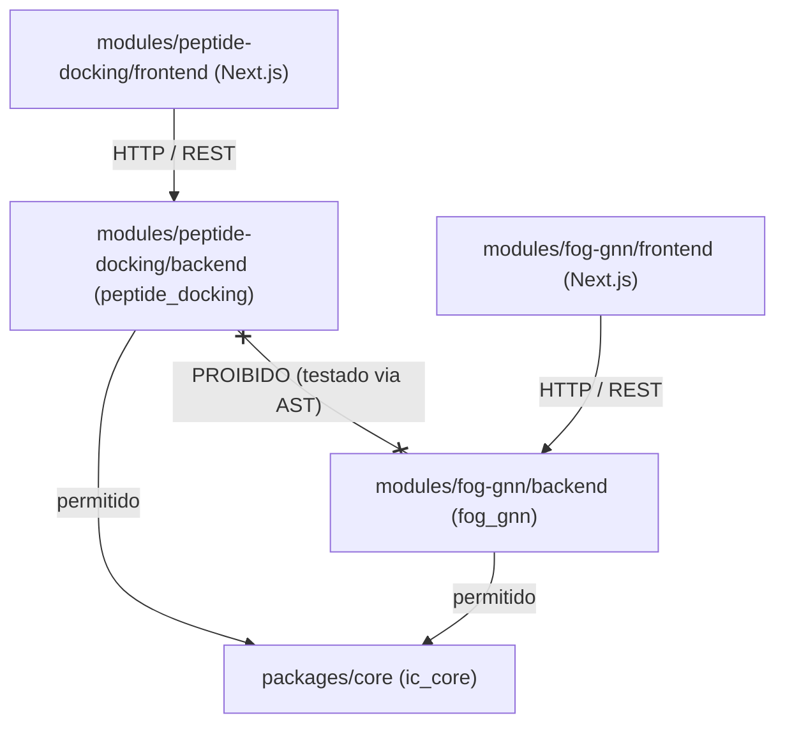

# Arquitetura do Monorepo `ic-research-lab`

## 1. Por que um Monorepo?

Este repositório abriga **duas iniciações científicas (ICs) independentes**:

1. **Módulo A (`peptide-docking`):** Triagem computacional automatizada de 634 peptídeos candidatos contra uma proteína-alvo de _Leishmania_ sem ortólogo humano.
2. **Módulo B (`fog-gnn`):** Predição de episódios de _Freezing of Gait_ (FOG) na Doença de Parkinson usando Redes Neurais em Grafos Espaço-Temporais (ST-GNN) sobre sensores inerciais corporais (IMU).

Embora pertençam a domínios científicos completamente distintos (bioinformática estrutural vs. aprendizado profundo em sinais biomédicos vestíveis), ambos os projetos compartilham **necessidades idênticas de engenharia de software para pesquisa reprodutível**:

- Carregamento tipado de variáveis de ambiente e caminhos de dados fora do repositório (`pydantic-settings`).
- Logging estruturado e sanitizado (sem vazamento de caminhos sensíveis ou identificadores de pacientes).
- Persistência tabular reprodutível, hashing determinístico de parâmetros e cache em disco para evitar recomputação.
- Padronização de qualidade de código (`ruff`, `mypy`, `pytest`, `eslint`, `prettier`, `pre-commit`) e pipeline de Integração Contínua (GitHub Actions) com execução seletiva por pacote modificado.

Manter ambos em um monorepo com **fronteira arquitetural rígida** evita duplicar infraestrutura de engenharia sem jamais acoplar a lógica científica.

---

## 2. O que é Compartilhado vs. O que é Isolado

| Camada                    | Compartilhado (`packages/core` e raiz)                              | Isolado por Módulo (`modules/<modulo>`)                                                                                          |
| :------------------------ | :------------------------------------------------------------------ | :------------------------------------------------------------------------------------------------------------------------------- |
| **Domínio Científico**    | Nada. Zero entidades bioquímicas ou clínicas no `core`.             | `peptide_docking.domain` vs. `fog_gnn.domain`                                                                                    |
| **Ambiente Python**       | Nenhum venv global único.                                           | Cada pacote Python possui seu próprio `pyproject.toml` + `uv.lock` (dependências de bioinformática não colidem com PyTorch/PyG). |
| **Frontend Web**          | `pnpm-workspace.yaml`, configs base de lint/format na raiz.         | Dois apps Next.js (App Router + TS) independentes, cada um com rota raiz própria (`/`), porta própria e deploy independente.     |
| **Infraestrutura Python** | `ic_core.config`, `ic_core.logging`, `ic_core.paths`, `ic_core.io`. | Pipelines, motores de docking, grafos corporais, modelos neurais, métricas e rotas FastAPI.                                      |
| **Dados**                 | Convenção `.env` + `.gitignore` agressivo na raiz.                  | Diretórios separados (`data/synthetic/peptide_docking` e `data/synthetic/fog_gnn`) e scripts geradores independentes.            |
| **CI / Qualidade**        | `.github/workflows/ci.yml`, `.pre-commit-config.yaml`, `Makefile`.  | Jobs em matriz executados de forma independente conforme o caminho alterado.                                                     |

---

## 3. Regra de Fronteira Dura entre Módulos

As regras de dependência são:

1. `ic_core` **não pode importar** `peptide_docking` nem `fog_gnn`.
2. `peptide_docking` **só pode importar** a biblioteca padrão, suas próprias dependências e `ic_core`. **Nunca** importa `fog_gnn`.
3. `fog_gnn` **só pode importar** a biblioteca padrão, suas próprias dependências e `ic_core`. **Nunca** importa `peptide_docking`.
4. Os frontends Next.js de cada módulo também não se importam entre si.

Essas regras são verificadas automaticamente na suíte de testes (`pytest`) inspecionando a Árvore Sintática Abstrata (AST) de todos os arquivos `.py` do repositório.

---

## 4. Princípios de Reprodutibilidade e Ética Científica

1. **Dados Nunca Entram no Git:**
   - Estruturas `.pdb`, bibliotecas reais `.csv`/`.parquet` e gravações `.mat`/`.h5` de sensores de pacientes são bloqueados pelo `.gitignore`.
   - Todo ambiente de desenvolvimento e CI opera sobre **dados sintéticos gerados por script** com semente fixa (`IC_RANDOM_SEED=42`).
2. **Rastreabilidade de Runs e Experimentos:**
   - Cada lote de docking (Módulo A) ou experimento de treino (Módulo B) salva um manifesto JSON contendo a semente, versão do engine/modelo, hiperparâmetros e timestamp UTC.
3. **Honestidade Científica no Módulo A (`peptide-docking`):**
   - Scores de docking molecular são **hipóteses computacionais de triagem**, sujeitas a falsos positivos conformacionais e limitações da função de pontuação.
   - A API e a interface web exibem explicitamente os parâmetros da run e classificam os resultados como _priorização para ensaio experimental_, nunca como "composto ativo comprovado".
   - O adaptador HPEPDOCK respeita _rate limits_, realiza cache em disco por hash de `(sequência, alvo, parâmetros)` e opera como _stub_ seguro caso submissão automatizada não esteja explicitamente habilitada ou autorizada pelos termos do serviço.
4. **Rigor Metodológico e Privacidade no Módulo B (`fog-gnn`):**
   - **Prevenção de Data Leakage:** Janelas temporais extraídas da mesma sessão de marcha possuem alta autocorrelação. Portanto, todo particionamento de treino/validação/teste é feito **estritamente por sujeito** (_Leave-One-Subject-Out_ — LOSO), garantindo que um paciente de teste jamais tenha janelas vistas no treino.
   - **Baseline Não-GNN Obrigatório:** O uso de GNN espaço-temporal só se justifica se superar ou complementar de forma mensurável um baseline temporal 1D (CNN/GRU) treinado sob exatamente o mesmo protocolo LOSO.
   - **Métricas para Evento Raro:** Episódios de FOG são minoritários no tempo total de marcha. Avaliar por acurácia global é metodologicamente inválido; o sistema reporta **AUPRC**, **Sensibilidade (Recall)**, **Especificidade**, **F1**, **Falsos Positivos por Hora (FP/h)** e **Latência de Detecção (s)**.
   - **Proteção de Dados Sensíveis:** Identificadores de pacientes são anonimizados (`SUBJ_XXX`) e nunca são emitidos em logs de erro ou rastreamento.
